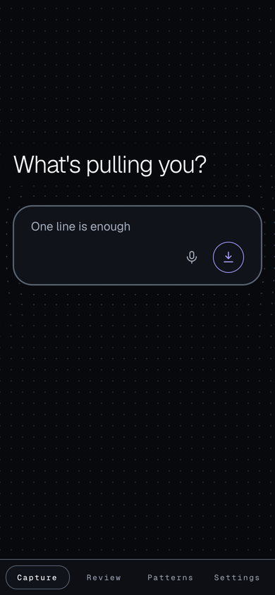

# TetherLog

**Log what's pulling you. Review later. See the pattern.**

ND capture log — dumb-fast park, agent-powered evening review, pattern detection, hands that export your `do` items.



TetherLog is a calm place to deal with what pulls at you. You park your own thoughts and sort them later, and a
coding agent can park questions for you too, as a deck of cards you answer one tap at a time. To try the second
half, open Review and press **See a sample deck**. Nothing leaves your device until you copy your answers.

See `ARCHITECTURE.md` for how it fits together, `PRODUCT.md` for the full spec and `docs/DECKS.md` for the deck
format.

Made by [Jennifer Hull](https://jenniferhull.co.za).

## Privacy

Captures stay on your device. Optional AI uses **your** API key (BYOK), stored in the browser only. Capture and patterns work without a key.

## Dev

```bash
npm install
npm run dev
```

## Stack

Vite · React 19 · TypeScript · Tailwind v4 · Dexie · PWA
